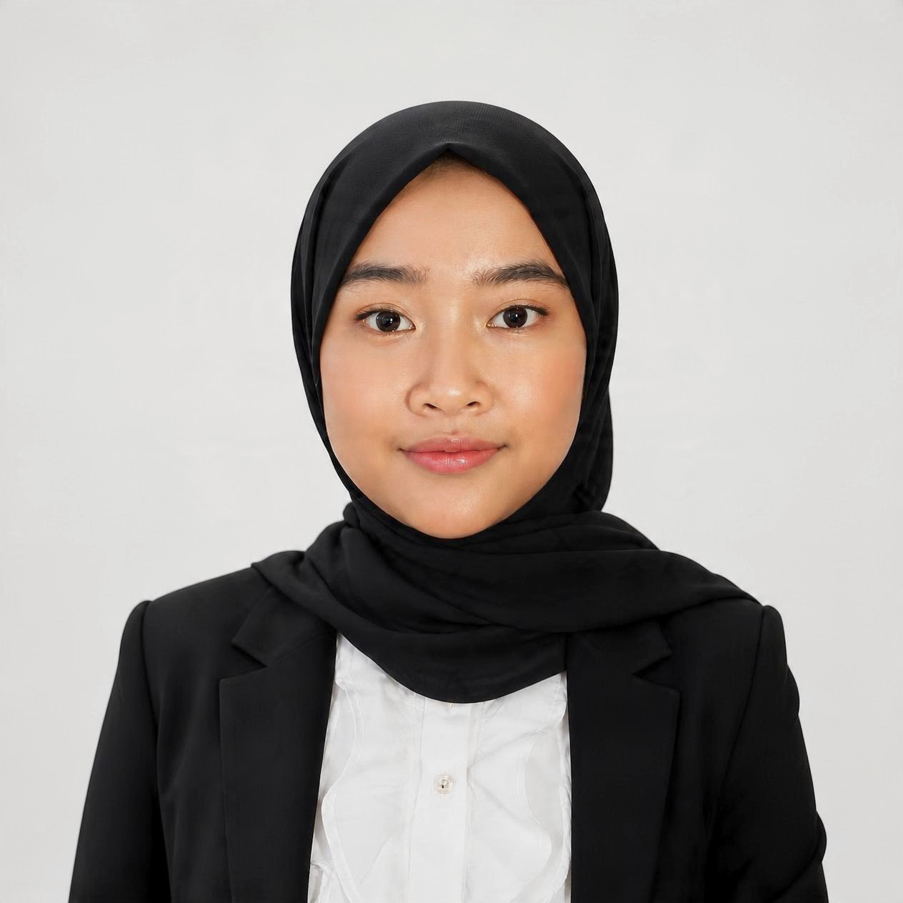

<!DOCTYPE html>
<html lang="en">
<head>
<meta charset="utf-8">
<meta name="viewport" content="width=device-width, initial-scale=1">
<title>Berliana Fadlilatur Rahmah</title>
<link rel="preconnect" href="https://fonts.googleapis.com">
<link rel="preconnect" href="https://fonts.gstatic.com" crossorigin>
<link href="https://fonts.googleapis.com/css2?family=Fraunces:opsz,wght,SOFT@9..144,300..500,0..100&family=Figtree:wght@400;500;600&display=swap" rel="stylesheet">

</head>
<body class="intro">

<i></i><i></i><i></i>

<nav>
  <a class="brand" href="#/home">Berliana</a>
  

    <a href="#/home" data-n="home">Home</a>
    <a href="#/experience" data-n="experience">Experience</a>
    <a href="#/projects" data-n="projects">Projects</a>
    <a href="#/research" data-n="research">Research</a>
    <a href="#/education" data-n="education">Education</a>
    <a href="#/certifications" data-n="certifications">Certifications</a>
    
  

</nav>

<main class="stage">

<section class="page" id="p-welcome">
  <svg class="wave" viewBox="0 0 1440 300" preserveAspectRatio="none" aria-hidden="true">
    <path d="M0 160C240 60 420 260 720 170S1200 70 1440 150V300H0Z" fill="#cde3e8" opacity=".55"/>
    <path d="M0 220C260 140 500 290 780 215S1220 150 1440 230V300H0Z" fill="#ddd8f3" opacity=".6"/>
  </svg>
  

    
    <h1>Hi, I'm Berliana.</h1>
    
I work with election, logistics, and risk data, and build tools that turn it into decisions.

    <a class="btn" href="#/home">Get to know me</a>
  

</section>

<section class="page" id="p-home">

  <h1>Data Analyst, Machine Learning, Operations &amp; Risk Analytics</h1>
  

    <a href="mailto:berlianafr@gmail.com">berlianafr@gmail.com</a>
    <a href="https://www.linkedin.com/in/berlianafr9" target="_blank" rel="noopener">linkedin.com/in/berlianafr9</a>
    <a href="https://github.com/berlianafr" target="_blank" rel="noopener">github.com/berlianafr</a>
  

  
Data-driven professional with 4+ years of experience at Indonesia's General Election Commission (KPU), spanning internal audit, procurement, logistics, and election analytics. I build data-driven tools, automate reporting, analyze operational risks, and apply machine learning to real-world business problems.

  
I combine Python, SQL, and data analytics with practical experience in operations, supply chain, procurement, and regulatory compliance.

  <h2 style="margin-top:2.5rem">Technical Skills</h2>
  

    
<b>Data Analytics &amp; Machine Learning:</b> Python, SQL, Microsoft Excel, Google Sheets, Google Colab, Scikit-learn, XGBoost, LightGBM, SHAP, Google Apps Script

    
<b>Data Processing &amp; Automation:</b> Data Cleaning, Data Validation, Data Analysis, Workflow Automation, Reporting Automation

    
<b>Operations &amp; Supply Chain:</b> Logistics Monitoring, Supply Chain Risk Management, Procurement Planning, Budget Estimation, Cost Analysis, Vendor Evaluation

    
<b>Audit &amp; Risk Management:</b> Internal Control Assessment, Risk Assessment, Regulatory Compliance, Financial Reconciliation, Transaction Vouching, Audit Documentation

    
<b>Systems Analysis &amp; Design:</b> UML Modeling, Business Requirements Analysis, Workflow and Process Modeling

  

</section>

<section class="page" id="p-experience">

  <h2>Experience</h2>
  

Election Technical Affairs Officer, KPU East Java<small>April 2026 to present</small>
<ul>
    <li>Analyzed East Java voter data to determine electoral district (dapil) requirements and support district design simulations.</li>
    <li>Developed a dynamic seat-allocation tool using the Sainte-Laguë method for 18 political parties across 11 DPR and 14 provincial DPRD districts, cutting processing time from days to hours.</li>
    <li>Administered legislative replacement (PAW) processes for the East Java Provincial DPRD and monitored progress across 38 regencies/cities.</li>
    <li>Facilitated electoral discussions with administrators, academics, and other stakeholders.</li></ul>

  

Logistics Monitoring and Evaluation Officer, KPU Logistics Bureau, Jakarta<small>July 2024 to April 2026</small>
<ul>
    <li>Compiled and analyzed logistics data from 552 work units (38 provinces and 514 regencies/cities) for nationwide consolidated reporting.</li>
    <li>Designed a centralized logistics monitoring system with standardized formats and input validation, replacing inconsistent manual Excel files.</li>
    <li>Mapped supply chain risks across 5 zones and 20 risk categories, identifying the top 4 risks per zone and nationally with zone-specific mitigation recommendations.</li>
    <li>Contributed to the initial 2029 Election Logistics Roadmap by defining business processes, outputs, steps, and deadlines.</li></ul>

  

Procurement Officer, KPU Logistics Bureau, Jakarta<small>July 2023 to July 2024</small>
<ul>
    <li>Planned nationwide logistics procurement for the 2024 General Election: 204.8 million registered voters, 820,161 polling stations, 10 logistics categories.</li>
    <li>Contributed to regional zoning and centralized procurement with LKPP, supporting efficiency of approximately Rp381 billion.</li>
    <li>Conducted nationwide market price surveys and prepared Estimated Costs (HPS) for designated zones.</li>
    <li>Monitored production of approximately 1.2 billion ballot sheets for compliance with specifications and quality requirements.</li></ul>

  

Internal Auditor, KPU, Jakarta<small>January 2022 to July 2023</small>
<ul>
    <li>Reviewed semiannual financial statements and reconciled cash balances and imprest funds.</li>
    <li>Advised regional work units on financial management, regulatory compliance, and internal controls.</li>
    <li>Supported development of risk management regulation PKPU No. 8 of 2023 through research, stakeholder discussions, and socialization materials.</li></ul>

  

Audit Intern, AR Utomo Public Accounting Firms, Surabaya<small>September 2021</small>
<ul>
    <li>Prepared audit working papers and performed transaction vouching and reconciliation to identify discrepancies.</li></ul>

  

Student Intern, Directorate General of Taxes<small>March to June 2021</small>
<ul>
    <li>Supported tax audits by reviewing financial records, preparing working papers, and reconciling ledger and bank data in Excel.</li>
    <li>Evaluated audit quality assurance procedures against SOPs and recommended process improvements.</li></ul>

</section>

<section class="page" id="p-projects">

  <h2>Projects</h2>
  <a class="card" href="#/seat">
    <h3>SEAT: Seat Allocation &amp; Electoral Candidate Selection</h3>
    
Google Apps Script, Google Sheets, Gemini API

    
Turns scanned election result forms into seat allocations and elected-candidate lists. AI extracts, humans verify, the system calculates.

  </a>

</section>

<section class="page" id="p-seat">

  <a class="back" href="#/projects">Back to projects</a>
  <h2>SEAT: Seat Allocation &amp; Electoral Candidate Selection</h2>
  
Personal project, ongoing. Google Apps Script, Google Sheets, Gemini API.

  <h3 class="s">Problem</h3>
  
Seat allocation from scanned election result forms (Formulir D Hasil) was slow, manual work.

  <h3 class="s">Solution</h3>
  
An end-to-end tool that turns the scanned PDFs into parliamentary seat allocations and elected-candidate lists. The Gemini API extracts vote counts, users verify them, then the Sainte-Laguë method and candidate selection run automatically.

  <h3 class="s">Outcome</h3>
  
Processing time dropped from days to hours, with centralized Google Drive exports and per-user calculation history.

  

How I built it
<ul>
    <li>Human-in-the-loop workflow: users verify extracted data before any calculation.</li>
    <li>Three rounds of testing added API error handling, retry, and a manual data-entry fallback.</li></ul>

</section>

<section class="page" id="p-research">

  <h2>Research &amp; Publications</h2>
  <h3 class="s" style="margin-top:0">Comparative Study of Predictive Models for Non-Performing Loan Prediction in a P2P Lending Company</h3>
  
The 2nd International Conference on Artificial Intelligence for Learning and Optimization (ICoAILO 2026), October 2026, paper presenter. To be published in Scopus-indexed conference proceedings.

  <ul>
    <li>Compared Logistic Regression, Decision Tree, Random Forest, XGBoost, and LightGBM on 578 corporate loan records with 17 scorecard features and an NPL rate of 8.7%.</li>
    <li>Handled class imbalance with stratified 5-fold cross-validation, class weights, and threshold tuning.</li>
    <li>Selected the model by misclassification cost, since a missed bad loan costs about 4.5 times more than a false alarm. XGBoost performed best.</li>
    <li>SHAP showed year-over-year revenue growth, payor type, and past-due receivables as top risk drivers. Financial factors made up 53% of model importance despite 20% of the original scorecard weight.</li>
  </ul>
  
<a href="https://zenodo.org/records/23138626" target="_blank" rel="noopener">Code and processed dataset on Zenodo</a>

</section>

<section class="page" id="p-education">

  <h2>Education</h2>
  

Bina Nusantara University (BINUS), B.Comp.Sc. Information Systems<small>August 2024 to October 2026, RPL (Diploma-to-Bachelor) program</small>
<ul>
    <li>Focus: data analytics and machine learning, systems analysis and design, UML modeling, business requirements analysis, project management.</li>
    <li>Thesis: Non-Performing Loan (NPL) prediction using machine learning, comparing five models on real corporate loan data and selecting the best by misclassification cost.</li></ul>

  

Polytechnic of State Finance STAN, A.Md.Ak. Accounting<small>September 2018 to October 2021</small>
<ul>
    <li>Focus: financial accounting, government accounting and compliance, cost accounting, product pricing, auditing.</li>
    <li>Final project: cost of production analysis at a bakery, applying process costing and recommending improvements to cost classification, recordkeeping, and pricing.</li></ul>

</section>

<section class="page" id="p-certifications">

  <h2>Licenses &amp; Certifications</h2>
  <ul>
    <li><b>Supervised Machine Learning: Regression and Classification</b>, DeepLearning.AI, Stanford University (February 2026)</li>
    <li><b>Certified Skilled Auditor</b>, BPKP (June 2024)</li>
    <li><b>Government Procurement Certification</b>, LKPP (April 2024)</li>
    <li><b>Certified Associate in Python Programming (PCAP)</b>, Python Institute (November 2021)</li>
  </ul>

</section>

</main>

</body>
</html>
